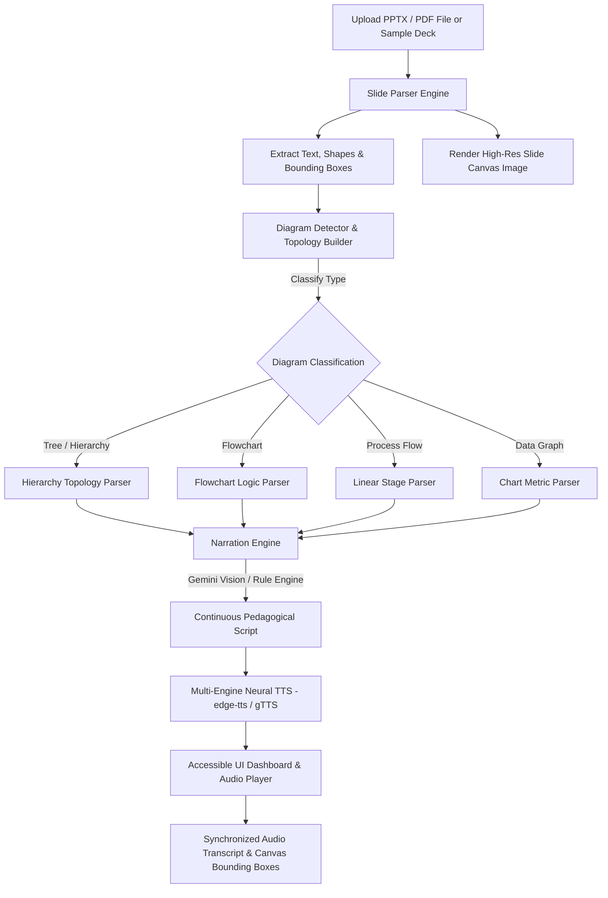

# AuraSlide Narrator 🎧📊
> **PS 03: Lecture Slides to Accessible Audio Content Converter**  
> *An EdTech visual-to-audio narrator that converts slide files (PPTX/PDF), detects graphic elements, parses diagrams, and structures continuous, natural spoken explanations for visually impaired students.*

---

## 📌 Problem Overview & Solution

### The Challenge
Visually impaired students struggle with lecture slides because traditional screen readers read raw, unformatted text boxes sequentially (e.g. reading a biology hierarchy tree as *"Box 1: Mammal, Box 2: Canine, Box 3: Canis Lupus"*). This fails to convey diagram relationships, logical flows, parent-child hierarchies, or visual trends.

### The Solution: AuraSlide Narrator
**AuraSlide Narrator** bridges this accessibility gap by combining Computer Vision shape parsing, multimodal AI diagram classification, and pedagogical narrative engines. 

Instead of disjointed text boxes, it narrates:
> *"This slide presents an evolutionary tree tracing Mammals down to Canines, which branches into Wolves and Dogs..."*

---

## ✨ Key Features & Highlights

- 🖼️ **Multi-Format Ingestion**: Supports PowerPoint (`.pptx`) and PDF (`.pdf`) lecture slide decks.
- 🌳 **Visual Diagram Topology Detection**:
  - **Hierarchy & Evolutionary Trees** (Taxonomy, Organization charts)
  - **Algorithmic Flowcharts** (Binary Search, Logic decisions)
  - **Sequential Process Lifecycles** (Supply chain, biology cycles)
  - **Data Graphs & Mathematical Expressions** (Kinematics curves, formulas)
- 🎙️ **Pedagogical Audio Narrator Engine**: Translates raw shapes into natural, contextual educational narratives. Supports **Gemini 2.5 Flash Vision API** and an offline structural rules engine.
- 🔊 **Multi-Engine Neural Text-to-Speech (TTS)**: Synthesizes high-clarity speech using `edge-tts` (Microsoft Neural Voices) & `gTTS` with variable speed controls (**0.75x to 2.0x** for screen reader power users).
- 🎯 **Synchronized Audio-Visual Canvas**: Sentence-by-sentence audio transcript sync with real-time bounding box highlighting on the slide canvas.
- ♿ **WCAG 2.1 AAA Accessibility Suite**:
  - **High Contrast Theme Mode** (Yellow/Cyan on Black for low vision)
  - **OpenDyslexia Font Support**
  - **Full Keyboard Navigation Shortcuts** (`Space` = Play/Pause, `Left/Right` = Slide Switch, `H` = High Contrast, `D` = Dyslexia Font, `L` = Logs Console)
  - **Screen-Reader ARIA Live Announcements** (`aria-live="polite"`)
- 📟 **Backend Execution Traces Console**: Live terminal debugger panel embedded directly in the UI displaying diagram detection confidence, graph topology, and TTS synthesis logs.

---

## 🏗️ Workflow & System Architecture



---

## 🛠️ Tech Stack

- **Backend**: Python 3.14, Flask, `python-pptx`, `PyMuPDF` (`fitz`), `Pillow`, `edge-tts`, `gTTS`, `google-genai`.
- **Frontend**: HTML5, Vanilla CSS3 (Custom Design System, Glassmorphism, Responsive Grid), JavaScript (ES6+ Web Audio API & Canvas Sync).
- **Design & Accessibility**: WCAG 2.1 AAA Compliant Palette, OpenDyslexia Typography, WAI-ARIA standard landmarks.

---

## 🚀 Quick Start Guide

### Prerequisites
- Python 3.10+ installed on Windows, macOS, or Linux.

### 1. Installation
Clone the repository and install required packages:
```bash
git clone https://github.com/your-username/lecture-slide-narrator.git
cd lecture-slide-narrator
python -m pip install -r backend/requirements.txt
```

### 2. (Optional) Configure Gemini API Key
To enable Multimodal Vision AI narration:
```powershell
$env:GEMINI_API_KEY="your_api_key_here"
```
*(Note: AuraSlide Narrator includes a built-in pedagogical structural engine and works 100% offline out-of-the-box even without an API key!)*

### 3. Launch Application
Run the one-click launcher script:
```bash
python run_app.py
```
The application will automatically open in your default browser at `http://127.0.0.1:5000`.

---

## 📁 Repository Structure

```
lecture-slide-narrator/
├── backend/
│   ├── app.py                  # Flask REST API server & log stream
│   ├── slide_parser.py         # PPTX & PDF shape/text/coordinate extractor
│   ├── diagram_detector.py     # Graph topology & visual layout analyzer
│   ├── narration_engine.py     # Pedagogical accessibility script generator
│   ├── tts_synthesizer.py      # edge-tts & gTTS multi-engine speech synthesizer
│   ├── sample_generator.py     # Pre-packaged demo lecture slide decks generator
│   └── requirements.txt        # Python dependency list
├── frontend/
│   ├── index.html              # WCAG AAA compliant single-page web app
│   ├── styles.css              # Custom dark mode, high contrast & dyslexia styles
│   └── app.js                  # Interactive slide canvas, audio sync & log console
├── run_app.py                  # One-click startup & browser launcher script
├── README.md                   # Full submission documentation
└── SOLUTION_SUMMARY.txt        # 3-4 line project summary
```

---

## 🎬 Demo Video & Testing Walkthrough

When recording your 4-minute demo video:
1. **Load Pre-packaged Demo Decks**: Click *Biology Evolutionary Tree*, *CS Binary Search Flowchart*, or *Supply Chain Process*.
2. **Observe Visual Diagram Detection**: Point out the *Detected Visual Graphic* tag (e.g. `Evolutionary Hierarchy Tree`) and *Detection Confidence score*.
3. **Audio-Visual Sync**: Click **Play**. Note how the sentence in the transcript highlights simultaneously with the bounding box node on the slide image canvas.
4. **Accessibility Features**: Press `H` to toggle **High Contrast Yellow-on-Black** mode and `D` to toggle **Dyslexia Font** mode.
5. **Backend Traces Panel**: Expand the **Backend Execution Traces Console** to demonstrate real-time terminal output, diagram classification, and TTS synthesis logs.

---

## 📄 License
Released under the MIT License. Built for accessibility and inclusive EdTech education.
